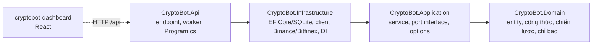
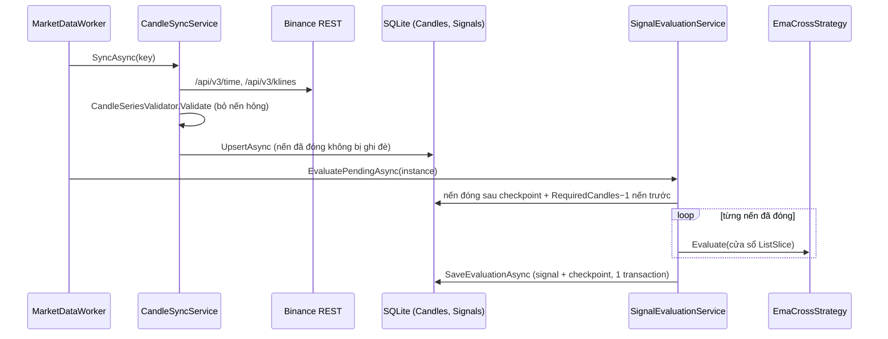
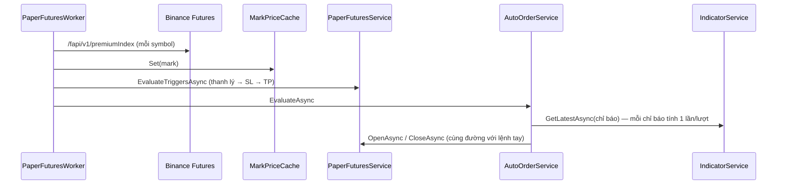

# Kiến trúc

## 1. Các tầng và hướng phụ thuộc

Backend chia 4 project theo kiểu Clean Architecture. Mũi tên là "tham chiếu tới":

| Project | Được biết tới | Không được biết tới | Package ngoài |
| --- | --- | --- | --- |
| **Domain** | Không gì cả | EF Core, HTTP, DI, logging, đồng hồ hệ thống, cấu hình | Không có |
| **Application** | Domain | EF Core, HTTP, ASP.NET | `Microsoft.Extensions.Logging.Abstractions` |
| **Infrastructure** | Application, Domain | ASP.NET | EF Core SQLite, `Microsoft.Extensions.Http` |
| **Api** | Tất cả | — | Serilog, OpenApi, EF Core Design |

Quy tắc chính:

- **Domain thuần túy.** Hàm trong Domain chỉ biến đầu vào thành đầu ra: không gọi API, không đọc đồng hồ, không đọc
  file, không giữ trạng thái giữa các lần gọi. Nhờ vậy test Domain không cần fake nào.
- **Application định nghĩa port, Infrastructure cài đặt.** Ví dụ `ICandleStore`, `IMarketDataClient`, `IClock`
  ([`Ports.cs`](../src/CryptoBot.Application/Abstractions/Ports.cs)), `IMarkPriceClient`, `IPaperFuturesStore`
  ([`PaperFuturesContracts.cs`](../src/CryptoBot.Application/Futures/PaperFuturesContracts.cs)), `IAutoOrderStore`.
  Service trong Application chỉ nhận interface, nên test Application dùng fake trong bộ nhớ.
- **Thời gian đi qua `IClock`.** Không gọi `DateTime.UtcNow` trong Application/Domain; Infrastructure cài
  `SystemClock`, test dùng `FakeClock`.
- **Api chỉ ghép nối.** Endpoint kiểm tra đầu vào, gọi service, đổi kết quả sang DTO. Không có công thức nghiệp vụ trong
  endpoint (ngoại lệ nhỏ đã biết: vòng "các lần đoán gần nhất" trong `PredictionEndpoints`).

## 2. Khởi động ([`Program.cs`](../src/CryptoBot.Api/Program.cs))

1. Đặt `CultureInfo.InvariantCulture` cho cả process: số trong thông báo lỗi luôn dùng dấu chấm, không phụ thuộc locale
   máy chủ.
2. Nạp `appsettings.json` + `marketevents.json`, cấu hình Serilog.
3. `AddInfrastructure(config)` ([`DependencyInjection.cs`](../src/CryptoBot.Infrastructure/DependencyInjection.cs))
   đăng ký mọi service, store, client, options.
4. Đăng ký 6 worker (`BackgroundService`).
5. JSON cho phép đọc số từ chuỗi (`"50.5"`) để số tiền không mất chính xác qua JSON number.
6. `InitializeDatabaseAsync`: tạo thư mục `data/`, chạy migration, bật `PRAGMA journal_mode=WAL`.
7. Tạo `IndicatorRegistry` ngay để lỗi cấu hình chỉ báo hiện trong log lúc khởi động.
8. `StrategyConfigurator.ApplyAsync`: đồng bộ chiến lược trong DB với `Strategies`; `EnsureFundedAsync`: nạp vốn giả lập
   lần đầu.
9. Map endpoint, phục vụ file tĩnh từ `wwwroot`, fallback `/api/**` → 404 JSON, mọi đường khác → `index.html`.

## 3. Worker chạy nền

| Worker | Chu kỳ | Việc làm |
| --- | --- | --- |
| [`MarketDataWorker`](../src/CryptoBot.Api/Workers/MarketDataWorker.cs) | `MarketData:PollInterval` (15s), backoff khi lỗi | Với mỗi (symbol, khung) của chiến lược đang bật + chỉ báo: `CandleSyncService.SyncAsync` rồi `SignalEvaluationService.EvaluatePendingAsync` cho từng chiến lược của cặp đó |
| [`PaperFuturesWorker`](../src/CryptoBot.Api/Workers/PaperFuturesWorker.cs) | `PaperFutures:MarkPollInterval` (2s) | Lấy mark price → `PaperFuturesService.EvaluateTriggersAsync` (thanh lý/SL/TP) → `AutoOrderService.EvaluateAsync` (quy tắc tự mở/đóng) |
| [`LivePriceWorker`](../src/CryptoBot.Api/Workers/LivePriceWorker.cs) | `LivePrices:PollInterval` (15s, `PeriodicTimer`) | `LivePriceSampler.SampleAsync`: Spot + Mark song song, ghi vào `LivePriceHistory` |
| [`DailyHistoryWorker`](../src/CryptoBot.Api/Workers/DailyHistoryWorker.cs) | `DailyHistory:PollInterval` (1h, `PeriodicTimer`) | `DailyHistorySyncService.SyncAsync` cho từng symbol Bitfinex |
| [`DailyReportWorker`](../src/CryptoBot.Api/Workers/DailyReportWorker.cs) | Mỗi ngày lúc `DailyReports:RunAt` (06:00 giờ VN); ngủ tối đa 1h mỗi lần, lỗi thì thử lại sau 5 phút | `DailyReportService.RunDueAsync`: lập báo cáo còn thiếu của giờ lập gần nhất (cũng tạo bù khi khởi động) |
| [`NewsWorker`](../src/CryptoBot.Api/Workers/NewsWorker.cs) | `News:PollInterval` (5h, `PeriodicTimer`), chạy một lượt khi khởi động | `NewsSyncService.SyncAsync`: lấy bài mới từ từng feed RSS |

Quy ước chung của worker:

- Mỗi vòng lặp tạo **DI scope riêng** (`IServiceScopeFactory.CreateAsyncScope`), nên mỗi vòng có `DbContext` riêng.
- Lỗi của một symbol được bắt và ghi log, **không làm dừng** vòng lặp hay các symbol khác. Chỉ
  `OperationCanceledException` lúc tắt app mới thoát vòng lặp.
- `MarketDataWorker` là **consumer tuần tự duy nhất** ghi strategy instance, nên không có hai tác vụ cùng ghi checkpoint.
- Paper futures: API và worker cùng ghi số dư/vị thế, nên mọi thao tác ghi đi qua `PaperFuturesLock` (một
  `SemaphoreSlim(1, 1)`).

## 4. Luồng dữ liệu chính

### 4.1 Nến → tín hiệu

### 4.2 Mark price → lệnh Paper

Lệnh tay từ dashboard đi `POST /api/paper/futures/quote` → `POST /orders` → `PaperFuturesService.OpenAsync`, tức là
**cùng một hàm** với lệnh tự động. Mọi kiểm tra (SL trước giá thanh lý, số dư, min notional, mark còn mới) chỉ viết
một lần.

### 4.3 Dashboard

Dashboard không tính gì quan trọng: nó gọi REST, hiển thị, và tự làm mới bằng TanStack Query
(`refetchInterval`: trạng thái 10s, tài khoản Futures 2s…). Đường EMA và giá trị chỉ báo trên chart được **backend**
tính bằng đúng quy tắc cửa sổ của chiến lược, nên chart luôn khớp với giá trị đã dùng để ra tín hiệu.

## 5. Lưu trữ

**Database:** SQLite, file `data/cryptobot.db` (đường dẫn tương đối với thư mục chạy API), WAL mode,
`Default Timeout=30`. Context: [`BotDbContext`](../src/CryptoBot.Infrastructure/Persistence/BotDbContext.cs).

| Bảng | Entity | Khóa duy nhất / index |
| --- | --- | --- |
| `Candles` | `Candle` | `(Exchange, Symbol, Interval, OpenTimeUtc)` duy nhất |
| `StrategyInstances` | `StrategyInstance` | `Name` duy nhất |
| `Signals` | `TradingSignal` | `(StrategyInstanceId, ConfigVersion, CandleOpenTimeUtc, Action)` duy nhất |
| `FuturesPositions` | `FuturesPosition` | `(Environment, OpenCommandId)` duy nhất (chống mở trùng) |
| `PaperLedger` | `PaperLedgerEntry` | `(Environment, TimeUtc)` |
| `AutoOrderRules` | `AutoOrderRule` | `CommandId` duy nhất |
| `DailyReports` | `DailyReport` | `(Symbol, PeriodEndUtc)` duy nhất; nội dung báo cáo lưu dạng JSON (`ContentJson`) |
| `NewsArticles` | `NewsArticle` | `(Source, ExternalId)` duy nhất; index `PublishedAtUtc` |

Quy ước lưu (áp cho **mọi** cột cùng kiểu, trong `ConfigureConventions`):

- `decimal` → `TEXT` chuỗi invariant (`DecimalInvariantStringConverter`). Giữ chính xác từng chữ số. Hệ quả:
  **không SUM/ORDER BY/so sánh cột decimal trong SQL**, phải đọc lên rồi tính trong C#.
- `DateTime` → Unix milliseconds `INTEGER` (`UtcUnixMillisecondsConverter`). Sắp xếp/so sánh được trong SQL. Ghi
  `DateTime` không phải UTC sẽ ném lỗi.
- Enum → chuỗi (`HasConversion<string>()`), đọc DB dễ hiểu.

Migration nằm trong [`Persistence/Migrations`](../src/CryptoBot.Infrastructure/Persistence/Migrations), chạy tự động khi
khởi động. Cách thêm migration: [extending.md](extending.md#5-thêm-hoặc-đổi-cột-trong-database-migration).

**Bộ nhớ (mất khi restart):** `MarketDataStatusRegistry`, `MarkPriceCache`, `LivePriceHistory`, cache nến ngày của
`DailyRangeService` (15 phút), `SimilarDaysCache` (theo ngày).

## 6. Nguồn dữ liệu bên ngoài

| Nguồn | Client | Endpoint dùng | Ghi chú |
| --- | --- | --- | --- |
| Binance Spot | [`BinanceMarketDataClient`](../src/CryptoBot.Infrastructure/Exchanges/Binance/BinanceMarketDataClient.cs) | `/api/v3/time`, `/api/v3/klines`, `/api/v3/ticker/price` | Công khai, không key, tối đa 1000 nến/request |
| Binance USDⓈ-M | [`BinanceFuturesMarkPriceClient`](../src/CryptoBot.Infrastructure/Exchanges/Binance/BinanceFuturesMarkPriceClient.cs) | `/fapi/v1/premiumIndex` | Mark price |
| RSS tin tức | [`RssNewsFeedClient`](../src/CryptoBot.Infrastructure/News/RssNewsFeedClient.cs) | Feed trong `News:Feeds` (CoinDesk, Cointelegraph, Decrypt) | RSS 2.0/Atom, gửi `User-Agent`; lỗi → `NewsFeedUnavailableException` |
| Bitfinex | [`BitfinexDailyHistoryClient`](../src/CryptoBot.Infrastructure/Exchanges/Bitfinex/BitfinexDailyHistoryClient.cs) | Nến 1d công khai | Cần `User-Agent`, tối đa 10000 nến/request |

Client dùng typed `HttpClient` đăng ký qua `AddHttpClient`, base URL và timeout lấy từ options. Lỗi tạm thời của sàn
(429, 418, 5xx, timeout, mạng) đổi thành `MarketDataUnavailableException` (kèm `RetryAfter` nếu sàn trả), để worker
biết đó là lỗi có thể thử lại.

## 7. Cấu hình được nạp thế nào

- Phần lớn options là class POCO đọc bằng `config.GetSection("X").Get<XOptions>() ?? new XOptions()` và đăng ký
  **singleton** (ví dụ `MarketDataOptions`, `PaperFuturesOptions`). Service nhận thẳng class options, không qua
  `IOptions<T>`.
- `BinanceOptions`, `BitfinexOptions` dùng `services.Configure<T>` vì `AddHttpClient` đọc qua `IOptions<T>`.
- Danh sách trong options (ví dụ `Symbols`) mặc định **rỗng**: binder của .NET cộng thêm phần tử từ cấu hình vào danh
  sách mặc định, nên để mặc định có phần tử sẽ gây trùng.

Chi tiết từng khóa: [configuration.md](configuration.md).
