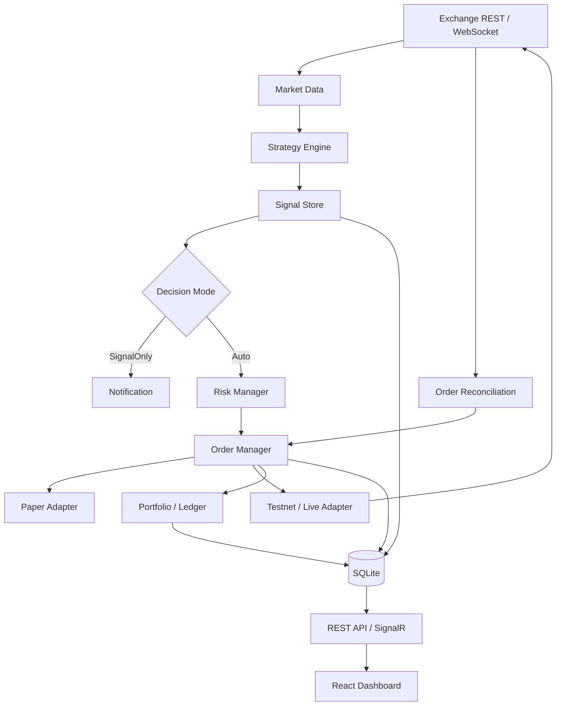

# Crypto Trading Bot cá nhân — Kiến trúc và lộ trình triển khai

> **Thiết kế ban đầu.** Tài liệu này là bản đề xuất kiến trúc và lộ trình viết trước khi bắt đầu code. Nó giữ lại các
> quyết định thiết kế và lý do, **không mô tả hiện trạng code**. Bot đang làm gì: [features.md](features.md); các tầng
> và luồng dữ liệu hiện tại: [architecture.md](architecture.md); nguyên tắc bắt buộc: [principles.md](principles.md).

**Ngôn ngữ:** C# / ASP.NET Core + React / TypeScript  
**Ngày biên soạn:** 18/10/2026  
**Mục đích:** Tài liệu thiết kế để nghiên cứu và triển khai cho một người sử dụng.

Đây là thiết kế phần mềm, chưa phải bot đã chạy hoặc chiến lược đã được chứng minh hiệu quả. EMA và các con số minh họa chỉ dùng để xây dựng, kiểm thử hệ thống; không bảo đảm lợi nhuận.

## Mục lục

1. [Mục tiêu và phạm vi](#1-mục-tiêu-và-phạm-vi)
2. [Công nghệ và quyết định kiến trúc](#2-công-nghệ-và-quyết-định-kiến-trúc)
3. [Kiến trúc tổng thể](#3-kiến-trúc-tổng-thể)
4. [Cấu trúc source code](#4-cấu-trúc-source-code)
5. [Domain và dữ liệu](#5-domain-và-dữ-liệu)
6. [Market Data và chiến lược](#6-market-data-và-chiến-lược)
7. [Trading Engine và quản lý lệnh](#7-trading-engine-và-quản-lý-lệnh)
8. [Quản lý rủi ro](#8-quản-lý-rủi-ro)
9. [Paper Trading và Backtesting](#9-paper-trading-và-backtesting)
10. [API và realtime](#10-api-và-realtime)
11. [React Dashboard](#11-react-dashboard)
12. [Bảo mật và vận hành](#12-bảo-mật-và-vận-hành)
13. [Kế hoạch triển khai](#13-kế-hoạch-triển-khai)
14. [Kiểm thử và điều kiện nghiệm thu](#14-kiểm-thử-và-điều-kiện-nghiệm-thu)
15. [Mở rộng và tài liệu tham khảo](#15-mở-rộng-và-tài-liệu-tham-khảo)

## 1. Mục tiêu và phạm vi

Xây dựng một ứng dụng theo dõi thị trường, tạo tín hiệu, thử nghiệm chiến lược và sau đó có thể tự đặt lệnh. Ưu tiên dễ hiểu, dễ vận hành và truy vết được từng quyết định.

### 1.1 Phạm vi MVP

| Thành phần | Phạm vi đề xuất |
| --- | --- |
| Sàn | Một adapter Binance Spot |
| Cặp giao dịch | BTCUSDT và ETHUSDT |
| Khung nến | 15m và 1h; trước tiên chạy một khung cho mỗi cặp |
| Chiến lược | EMA 9/21 trên nến đã đóng |
| Giao dịch | Long-only Spot; SELL chỉ giảm lượng tài sản bot đang quản lý |
| Thực thi ban đầu | Paper Trading |
| Dashboard | Nến, EMA, tín hiệu, lệnh, vị thế, equity và trạng thái bot |
| Người dùng | Một tài khoản quản trị |
| Triển khai | Một máy, một backend, một database |

Loại khỏi MVP: Futures, margin, đòn bẩy, nhiều sàn, nhiều người dùng, arbitrage, HFT và AI dự đoán giá.

### 1.2 Phân biệt chế độ quyết định và môi trường thực thi

Không gộp tất cả thành một biến `Mode` khó kiểm soát:

- `DecisionMode = SignalOnly | Auto`: chỉ phát tín hiệu hay cho phép tạo ý định đặt lệnh.
- `ExecutionEnvironment = Paper | Testnet | Live`: lệnh được xử lý ở đâu.
- Backtest là một phiên chạy lịch sử riêng, có dữ liệu và sổ vốn riêng.

`SignalOnly` không tự đặt lệnh. `Auto + Paper` tự thực thi giả lập. `Auto + Live` mới sử dụng tiền thật. Testnet kiểm tra tích hợp API, không đại diện đầy đủ cho thanh khoản hoặc kết quả giao dịch thực tế.

Mặc định khởi tạo là `SignalOnly + Paper`, live bị khóa. Không tự chuyển môi trường nếu API lỗi.

## 2. Công nghệ và quyết định kiến trúc

| Lớp | Công nghệ đề xuất | Lý do trong dự án này |
| --- | --- | --- |
| Backend | C#, ASP.NET Core, phiên bản LTS còn được hỗ trợ khi bắt đầu | Tận dụng kinh nghiệm .NET |
| Tác vụ nền | BackgroundService | Chạy luồng dữ liệu và giao dịch trong cùng ứng dụng |
| Frontend | React + TypeScript + Vite | Dashboard tách khỏi engine |
| UI | Ant Design | Form, bảng và cấu hình |
| Biểu đồ | TradingView Lightweight Charts | Hiển thị nến và chỉ báo; kiểm tra giấy phép/attribution khi tích hợp |
| Realtime | SignalR | Truyền cập nhật backend đến dashboard |
| Lưu trữ | EF Core + SQLite | Dễ chạy cho một người, ít tiến trình |
| Logging | Serilog, log có cấu trúc | Truy vết theo signal/order |
| Đóng gói | Docker Compose | Khởi động và sao lưu nhất quán |
| Kiểm thử | xUnit và kiểm thử tích hợp SQLite | Kiểm tra logic tiền, trạng thái và unique constraint |

C# phù hợp làm engine/API vì dự án tận dụng kinh nghiệm sẵn có với hệ sinh thái .NET. Python có thể bổ sung cho nghiên cứu thống kê sau này; chưa cần đưa vào đường xử lý lệnh của MVP.

Chọn **Modular Monolith**: chia module trong code, triển khai cùng một backend. Chưa cần Redis, RabbitMQ, Kafka hay Kubernetes. Khi triển khai có thể build React rồi phục vụ file tĩnh cùng ASP.NET Core để chỉ còn một ứng dụng và file SQLite.

Khóa phiên bản SDK và package sau khi kiểm tra tương thích; không dùng tag `latest` trong cấu hình triển khai.

## 3. Kiến trúc tổng thể



Ranh giới trách nhiệm:

- **Market Data:** tải, chuẩn hóa và kiểm tra tính liên tục của nến.
- **Strategy:** biến dữ liệu đầu vào thành quyết định; không gọi API sàn.
- **Risk:** quyết định có cho mở lệnh và kích thước tối đa.
- **Order Manager:** lưu ý định, gửi lệnh, theo dõi trạng thái, chống gửi trùng.
- **Portfolio:** cập nhật số dư/vị thế từ fill thực tế, không từ tín hiệu.
- **Reconciliation:** đối chiếu trạng thái local với sàn khi restart/mất kết nối.
- **API/UI:** gửi yêu cầu điều khiển; engine vẫn hoạt động khi đóng dashboard.

Dùng hàng đợi trong bộ nhớ có giới hạn, ví dụ `Channel<T>`, giữa các worker. Dữ liệu quan trọng phải được lưu trước; queue chỉ đánh thức xử lý, không phải nơi lưu bền vững.

Chạy một engine có quyền ghi và giao dịch. Không scale backend thành nhiều replica khi chưa có cơ chế điều phối và khóa phân tán.

## 4. Cấu trúc source code

```text
CryptoTradingBot/
├── src/
│   ├── CryptoBot.Domain/
│   │   ├── MarketData/
│   │   ├── Strategies/
│   │   ├── Trading/
│   │   ├── Risk/
│   │   └── Portfolio/
│   ├── CryptoBot.Application/
│   │   ├── Abstractions/
│   │   ├── Signals/
│   │   ├── Execution/
│   │   ├── Reconciliation/
│   │   └── Backtesting/
│   ├── CryptoBot.Infrastructure/
│   │   ├── Exchanges/Binance/
│   │   ├── Persistence/
│   │   ├── PaperTrading/
│   │   └── Notifications/
│   ├── CryptoBot.Api/
│   │   ├── Endpoints/
│   │   ├── Hubs/
│   │   └── Workers/
│   └── cryptobot-dashboard/
│       └── src/
│           ├── pages/
│           ├── features/
│           ├── components/
│           └── api/
├── tests/
│   ├── CryptoBot.Domain.Tests/
│   ├── CryptoBot.Application.Tests/
│   └── CryptoBot.IntegrationTests/
├── deploy/
├── docs/
└── CryptoTradingBot.sln
```

Domain không phụ thuộc EF Core, HTTP hoặc SDK sàn. Application tham chiếu Domain và định nghĩa interface. Infrastructure triển khai interface. Api là composition root ghép các phần lại.

Không bắt buộc thêm MediatR/CQRS hoặc generic repository. Application service và EF Core trực tiếp trong implementation phù hợp đã đủ cho MVP.

Các interface trọng tâm:

```csharp
// Phác thảo hợp đồng, chưa phải source code hoàn chỉnh.
public interface IStrategy
{
    StrategyDecision Evaluate(StrategyContext context);
}

public interface IRiskManager
{
    RiskDecision Evaluate(OrderIntent intent, RiskContext context);
}

public interface IExecutionAdapter
{
    Task<SubmitResult> SubmitAsync(OrderIntent intent, CancellationToken ct);
    Task<OrderSnapshot?> FindAsync(OrderLookup lookup, CancellationToken ct);
    Task<CancelResult> CancelAsync(OrderLookup lookup, CancellationToken ct);

    // Dùng cho đối chiếu khi khởi động lại / mất user stream (mục 7.3).
    Task<IReadOnlyList<OrderSnapshot>> GetOpenOrdersAsync(string? symbol, CancellationToken ct);
    Task<FillPage> GetFillsAsync(string symbol, FillCheckpoint since, CancellationToken ct);
    Task<IReadOnlyList<AssetBalance>> GetBalancesAsync(CancellationToken ct);
    Task<IReadOnlyList<Transfer>> GetTransfersAsync(DateTime sinceUtc, CancellationToken ct); // nạp/rút, mục 8.1
}
```

`StrategyContext` chứa nến đã đóng, vị thế của strategy instance và phiên bản cấu hình. Ba hàm cuối của `IExecutionAdapter` phục vụ bước đồng bộ số dư, lệnh mở và fill trong mục 7.3. `FillCheckpoint` gồm thời điểm và trade id cuối đã ghi; `FillPage` có con trỏ trang tiếp theo vì sàn giới hạn số fill mỗi lần gọi. Paper adapter cũng phải triển khai đủ cả ba hàm từ sổ mô phỏng của nó, để recovery chạy cùng một đường cho Paper và Live. `SubmitResult` phải phân biệt đã chấp nhận, bị từ chối và chưa biết kết quả. Tất cả I/O hỗ trợ timeout và cancellation.

Hosted worker tạo DI scope cho mỗi đơn vị xử lý hoặc dùng `IDbContextFactory`; không chia sẻ một DbContext giữa nhiều tác vụ. Xem [hướng dẫn hosted services của Microsoft](https://learn.microsoft.com/en-us/aspnet/core/fundamentals/host/hosted-services).

## 5. Domain và dữ liệu

### 5.1 Entity chính

| Entity | Trường quan trọng / trách nhiệm |
| --- | --- |
| Account | Id, Exchange, Environment, Name; một tài khoản sàn (hoặc sổ Paper) trong đúng một môi trường |
| Candle | Exchange, Symbol, Interval, OpenTimeUtc, OHLCV, IsClosed |
| StrategyInstance | Id, Name, Version, VersionEffectiveFromUtc, Parameters, Symbol, Interval, Enabled |
| TradingSignal | StrategyInstanceId, CandleOpenTimeUtc, Action, Reason, ConfigVersion |
| OrderIntent | AccountId, Environment, Symbol, StrategyInstanceId, SignalId, PositionId, Purpose (Entry/Exit), Source (Signal/Stop/TakeProfit/Manual/KillSwitch), CommandId, Status, Side, Quantity, PlannedStop, ClientOrderId |
| Order | AccountId, Environment, Symbol, IntentId, ExchangeOrderId, ClientOrderId, Status, RequestedQty, FilledQty |
| Fill | AccountId, Exchange, Environment, Symbol, ExchangeTradeId, OrderId, Price, Qty, FeeAmount, FeeAsset |
| Position | AccountId, Environment, StrategyInstanceId, Symbol, Qty, AverageCost |
| LedgerEntry | AccountId, Environment, TimeUtc, Asset, Amount, EntryType (Fill/Fee/Deposit/Withdrawal/Adjustment), SourceId |
| EquitySnapshot | TimeUtc, Environment, Equity, RealizedPnl, UnrealizedPnl |
| RiskState | AccountId, DayUtc, DayStartEquity, NetTransfersToday, LossLimitBreached, KillSwitch |
| BacktestRun | DatasetId, StrategyVersion, ConfigSnapshot, Metrics, Status |
| NotificationOutbox | EventKey, Payload, Attempts, NextAttemptAt, SentAt |
| AuditEvent | Actor, Action, OldValue, NewValue, TimeUtc, CorrelationId |

Mọi bảng giao dịch phải phân biệt Paper/Testnet/Live. `Environment` và `Exchange` trên Order/Fill/Intent là bản sao từ `Account` để index và lọc không cần join; khi ghi phải khớp với account. Backtest dùng `RunId` và portfolio riêng. Lệnh thủ công trên sàn được xem là dữ liệu bên ngoài; không tự gán chúng cho chiến lược của bot.

### 5.2 Index và tính nhất quán

- Unique Candle: `(Exchange, Symbol, Interval, OpenTimeUtc)`.
- Unique Signal: `(StrategyInstanceId, CandleOpenTimeUtc, Action)`. `ConfigVersion` vẫn được lưu trên signal để truy vết, nhưng **không** nằm trong khóa: nếu có, đổi cấu hình sẽ cho phép cùng một nến sinh signal thứ hai.
- Unique Intent theo signal: `(SignalId, Environment, Purpose) WHERE SignalId IS NOT NULL`.
- Unique exit đang hoạt động: `(PositionId) WHERE Purpose = 'Exit' AND Status` còn hoạt động, tức là chưa ở trạng thái kết thúc của mục 7.2 (Filled, Canceled, Expired, Rejected, NotPlaced).
- Unique lệnh điều khiển: `(CommandId) WHERE CommandId IS NOT NULL`.
- Unique entry đang hoạt động: `(StrategyInstanceId, Environment) WHERE Purpose = 'Entry' AND Status` còn hoạt động (như trên). Đây là ràng buộc cứng; kiểm tra "chưa có vị thế/pending entry" trong code chỉ là lớp thứ hai.
- Unique ClientOrderId: `(AccountId, ClientOrderId)`; account đã xác định sàn và môi trường.
- Unique Fill: `(AccountId, Symbol, ExchangeTradeId)`; trade id của Binance chỉ duy nhất trong một symbol.
- Index truy vấn theo trạng thái lệnh, thời gian và strategy instance.

Mọi cột trong các khóa trên phải có trong bảng entity ở mục 5.1; khi đổi entity thì sửa khóa trong cùng thay đổi.

Exit từ `ClosePositions`, stop, take-profit hay kill switch không có signal, nên `SignalId = NULL`. SQLite coi các NULL là khác nhau, vì vậy khóa theo signal không chặn được exit trùng. Mọi exit, bất kể nguồn, phải đi qua **một chỗ exit duy nhất cho mỗi vị thế** (partial unique index ở trên). Nếu đã có exit đang chạy mà một nguồn khác cũng muốn thoát (ví dụ stop chạm khi lệnh `ClosePositions` đang chờ), OMS cập nhật hoặc hủy-rồi-thay exit hiện có sau khi sàn xác nhận, không tạo intent thứ hai. Lượng exit luôn ≤ `Position.Qty` trừ lượng của exit đang chờ. `CommandId` do dashboard sinh cho mỗi lần bấm, nên bấm hai lần chỉ tạo một yêu cầu.

Trong một transaction: ghi signal và outbox; khi xử lý fill, ghi fill, ledger và vị thế cùng nhau. Unique constraint ngăn webhook/stream event lặp làm tăng số dư hai lần.

### 5.3 Tiền, thời gian và SQLite

Trong C# dùng `decimal` cho giá, lượng và tiền. Timestamp lưu UTC hoặc Unix milliseconds; UI đổi sang giờ Việt Nam. Không dùng giờ trình duyệt để quyết định nến đóng.

SQLite/EF Core có giới hạn khi so sánh và sắp xếp `decimal`; cần thiết kế mapping rõ ràng. Tham khảo [giới hạn SQLite provider](https://learn.microsoft.com/en-us/ef/core/providers/sqlite/limitations).

Đề xuất MVP: lưu giá trị tiền dưới dạng chuỗi decimal invariant chính xác, parse về decimal để tính toán trong application trên tập dữ liệu nhỏ đã lọc theo thời gian/cặp. Không dùng SQL `SUM` hoặc sắp xếp chuỗi cho số tiền. Khi cần truy vấn số học lớn, cân nhắc scaled integer có kiểm tra scale/overflow hoặc chuyển PostgreSQL với `numeric`.

Không chuyển tiền sang `double` chỉ để thuận tiện query. Các mảng số dành riêng cho biểu đồ có thể chuyển đổi ở biên hiển thị.

Giữ transaction ngắn, bật WAL khi phù hợp và cấu hình busy timeout. Chạy backtest nặng ngoài luồng engine giao dịch, giới hạn tài nguyên; có thể đọc snapshot dữ liệu riêng. Sao lưu bằng cơ chế backup SQLite nhất quán thay vì copy file DB đang ghi tùy tiện.

## 6. Market Data và chiến lược

### 6.1 Pipeline dữ liệu

1. Tải metadata của symbol, quy tắc số lượng/giá và nến lịch sử qua REST.
2. Nạp ít nhất `LookbackCandles` nến đã đóng (mục 6.2); chưa đủ thì trả `Hold` với lý do "Warm-up".
3. Kết nối stream để cập nhật nến đang chạy cho UI.
4. Chỉ phát sự kiện phân tích khi nến được xác nhận đóng.
5. Upsert theo khóa nến; phát hiện nến trùng, thiếu, sai thứ tự và giá trị không hợp lệ.
6. Sau reconnect: tải bù khoảng thiếu, sắp thứ tự, cập nhật chỉ báo rồi mới cho engine hoạt động lại.

Nến cũ tải bù dùng phục hồi chỉ báo và lịch sử; mặc định không đặt lệnh live dựa trên các tín hiệu đã quá hạn. Lưu thời điểm nhận cuối để phát hiện dữ liệu stale. Khi stale: chặn entry mới và giữ luồng quản lý lệnh/vị thế.

Chi tiết giao thức stream cần đối chiếu [tài liệu market streams chính thức](https://github.com/binance/binance-spot-api-docs/blob/master/web-socket-streams.md) khi viết adapter.

### 6.2 EMA crossover mẫu

Công thức: `EMA_t = alpha × Close_t + (1 − alpha) × EMA_(t−1)`, với `alpha = 2 / (period + 1)`.

**Cửa sổ cố định.** Mỗi nến `t` được đánh giá trên **đúng `N = LookbackCandles` nến đã đóng gần nhất kết thúc tại `t`**, không phụ thuộc đã nạp bao nhiêu lịch sử. Trong cửa sổ đó, seed EMA bằng SMA của `period` nến đầu cửa sổ, rồi cập nhật tuần tự tới `t`. EMA tại nến `t−1` (cần cho giao cắt) được tính trên cửa sổ kết thúc tại `t−1`.

Nếu seed theo nến đầu tiên của toàn bộ lịch sử đã nạp, EMA sẽ phụ thuộc điểm bắt đầu. Live nạp 500 nến gần nhất, còn backtest bắt đầu từ đầu dataset, nên hai bên ra EMA lệch nhau ở cùng một nến, và một lần gần giao cắt có thể phát tín hiệu ở chế độ này mà không ở chế độ kia. Cửa sổ cố định giúp chart, paper, backtest và live ra cùng giá trị trên cùng dữ liệu.

- `LookbackCandles` là tham số của strategy instance, nằm trong config version và được lưu cùng mỗi backtest.
- Bắt buộc `N ≥ periodChậm + 1` để có EMA của nến trước. Khuyến nghị `N ≥ 4 × periodChậm` (ví dụ 84 với EMA21) để ảnh hưởng của seed còn dưới khoảng 0,5%.
- Cửa sổ có nến thiếu hoặc sai thứ tự → `Hold`, không nội suy.

- Entry BUY khi EMA9 trước đó ≤ EMA21 và EMA9 hiện tại > EMA21, đồng thời chưa có vị thế/pending entry.
- Exit SELL khi EMA9 trước đó ≥ EMA21 và EMA9 hiện tại < EMA21, nếu có lượng tài sản bot sở hữu.
- Không giao cắt: `Hold`.
- Mỗi nến đóng được đánh giá đúng một lần cho mỗi strategy instance, theo config version đang hiệu lực tại nến đó.
- Lưu cấu hình mới đặt `VersionEffectiveFromUtc` = thời điểm mở của nến **kế tiếp** chưa đóng. Nến đã đánh giá không bao giờ được đánh giá lại với version mới.

Nếu chạy 15m và 1h độc lập trên cùng cặp, phải tách strategy instance và phân bổ vốn. MVP đơn giản hơn bằng cách chỉ cho một instance quản lý một cặp. Nếu dùng 1h làm bộ lọc của 15m, chỉ dùng nến 1h đã đóng tại thời điểm ra quyết định.

## 7. Trading Engine và quản lý lệnh

### 7.1 Luồng entry

1. Lưu signal với lý do và phiên bản cấu hình.
2. Kiểm tra DecisionMode, trạng thái bot, môi trường và độ mới của signal.
3. Risk Manager tính lượng giao dịch, kiểm tra số dư, hạn mức và pending orders.
4. Trong transaction, giữ chỗ ngân sách và ghi intent với ClientOrderId ổn định.
5. Dispatcher đọc intent, đánh dấu đang gửi rồi gọi execution adapter.
6. Cập nhật trạng thái từ phản hồi và sự kiện tài khoản.
7. Chỉ fill đã xác nhận mới cập nhật ledger/vị thế.
8. Phát cập nhật SignalR và ghi outbox thông báo.

Khóa xử lý theo account/symbol hoặc dùng một consumer cho OMS trong MVP để tránh hai tín hiệu cùng tiêu một số dư. Phải tính cả vốn đã giữ chỗ cho pending orders.

### 7.2 Vòng đời lệnh

| Từ | Sự kiện | Đến |
| --- | --- | --- |
| IntentCreated | Dispatcher bắt đầu gửi | Submitting |
| Submitting | Sàn chấp nhận (ACK) | New |
| Submitting | Sàn từ chối | Rejected |
| Submitting | **Fill đến trước ACK** | PartiallyFilled hoặc Filled (theo `FilledQty`) |
| Submitting | Timeout, lỗi mạng, phản hồi không rõ | Unknown |
| New | Sàn từ chối/hết hạn sau khi đã nhận (ví dụ kiểm tra phía sàn, IOC/FOK, self-trade prevention) | Rejected / Expired |
| New, PartiallyFilled | Có fill | PartiallyFilled hoặc Filled |
| New, PartiallyFilled | Hủy được xác nhận | Canceled |
| New, PartiallyFilled | Hết hạn | Expired |
| Unknown | Tra cứu thấy lệnh trên sàn | Đúng trạng thái sàn báo (New, PartiallyFilled, Filled, Canceled, Expired, Rejected) |
| Unknown | Có fill (từ stream hoặc tra cứu fill) | PartiallyFilled hoặc Filled |
| Unknown | Sàn xác nhận không có lệnh và không có fill, sau thời gian chờ đã cấu hình | NotPlaced (giải phóng tiền giữ chỗ) |
| Unknown | Chưa phân giải được | Giữ Unknown, khóa entry liên quan, tra cứu lại theo lịch |

Trạng thái kết thúc: Filled, Canceled, Expired, Rejected, NotPlaced.

Quy tắc áp dụng event:

1. **Fill luôn được ghi trước**, bất kể lệnh đang ở trạng thái nào: ghi fill, ledger, vị thế trong một transaction, chống trùng bằng khóa unique Fill. Trạng thái lệnh được suy ra sau đó. Không bao giờ bỏ một fill vì "chuyển trạng thái không hợp lệ".
2. **Chỉ tiến, không lùi.** `FilledQty` không giảm, trạng thái kết thúc không quay về trạng thái mở. Event đến muộn (ví dụ ACK `New` đến sau fill) chỉ bổ sung dữ liệu như `ExchangeOrderId`, không kéo trạng thái lùi.
3. Lệnh Canceled/Expired vẫn có thể nhận fill đến muộn (khớp trước khi hủy): tăng `FilledQty`, giữ trạng thái, và không hoàn toàn bộ tiền giữ chỗ.
4. Event không khớp dòng nào trong bảng (ví dụ fill cho lệnh Rejected hoặc NotPlaced) không bị bỏ qua: ghi `AuditEvent`, chặn entry trên symbol đó và đưa lệnh vào đối chiếu.

`Unknown` là trạng thái nội bộ khi chưa biết sàn có nhận lệnh hay chưa.

Binance nêu rằng timeout có thể để trạng thái thực thi chưa xác định. Không kết luận lệnh thất bại chỉ từ timeout; xem [tài liệu REST chính thức](https://github.com/binance/binance-spot-api-docs/blob/master/rest-api.md).

Do đó, không retry mù lệnh đặt mua/bán. Tra cứu theo client/exchange order id, đối chiếu open orders và fills. ClientOrderId là khóa truy vết, không tự bảo đảm exactly-once phía sàn; unique constraint local và reconciliation phải cùng hoạt động. Nếu vẫn chưa phân giải được thì giữ trạng thái Unknown và khóa entry liên quan.

### 7.3 Khởi động lại

1. Khởi động ở `Recovering`, chưa nhận entry.
2. Đọc intent chưa hoàn tất, lệnh mở, vị thế và risk state từ DB.
3. Đồng bộ số dư (`GetBalancesAsync`), open orders (`GetOpenOrdersAsync`) và lịch sử fill (`GetFillsAsync`) kể từ checkpoint có khoảng chồng lấn.
4. Deduplicate fill, xử lý chênh lệch, khôi phục lệnh bảo vệ.
5. Kiểm tra dữ liệu thị trường và cấu hình hiện hành.
6. Chuyển `Ready`; nếu không đối chiếu được thì ở `Paused/Degraded` và báo rõ lý do.

Có thể dùng retry với exponential backoff và jitter cho truy vấn an toàn; request đặt/hủy lệnh cần chính sách riêng dựa trên trạng thái đã xác nhận. Đọc rate limit từ phản hồi/metadata, không hard-code tốc độ gửi.

## 8. Quản lý rủi ro

### 8.1 Các giới hạn phải có

- Vốn tối đa cho mỗi chiến lược/cặp và tổng vốn sử dụng.
- Rủi ro theo stop cho mỗi entry; tính trên equity thuộc ngân sách bot.
- Số vị thế, số lệnh pending và số entry trong một khoảng thời gian.
- Giới hạn lỗ ngày theo realized + unrealized equity change, điều chỉnh nạp/rút.
- Spread/slippage tối đa chấp nhận, độ mới của dữ liệu và số lỗi liên tiếp.
- Chặn entry khi thiếu stop hợp lệ, chưa đối chiếu xong hoặc có Unknown order.
- Hạn mức lỗ ngày được lưu bền vững, restart không reset. Quy ước ngày UTC rõ trên UI.

Công thức lỗ ngày, có trừ nạp/rút:

```text
NetTransfersToday = Σ Deposit − Σ Withdrawal (LedgerEntry trong ngày UTC, quy ra đồng định giá)
DailyPnl          = Equity hiện tại − DayStartEquity − NetTransfersToday
Khóa entry khi    DailyPnl ≤ −DailyLossLimit
```

Ví dụ: đầu ngày 1.000 USDT, rút 300 USDT, giá không đổi. Equity còn 700, `NetTransfersToday = −300`, nên `DailyPnl = 700 − 1.000 − (−300) = 0`. Không khóa nhầm.

Nạp/rút được ghi thành `LedgerEntry` loại `Deposit`/`Withdrawal`, lấy qua `IExecutionAdapter.GetTransfersAsync` trong bước đối chiếu (Paper ghi trực tiếp khi người dùng nạp/rút vốn giả). Nếu số dư thay đổi mà không giải thích được bằng fill hay nạp/rút đã biết, đó là chênh lệch: chặn entry và yêu cầu người dùng xác nhận, giống trường hợp giao dịch thủ công ở mục 12.3. `NetTransfersToday` được cập nhật trong cùng transaction với bút toán và reset khi sang ngày UTC mới.

Các ngưỡng phải do người dùng cấu hình sau thử nghiệm. Ví dụ sau chỉ để kiểm tra phép tính, không phải phân bổ vốn được khuyến nghị.

```text
Equity giả lập      = 1.000 USDT
Risk fraction mẫu   = 0,5%
Risk budget         = 5 USDT
Giá entry giả định  = 100 USDT
Stop giả định       = 98 USDT
Qty sơ bộ           = 5 / (100 - 98) = 2,5 đơn vị
```

Sau đó trừ dự phòng phí/slippage, giới hạn theo tiền khả dụng, vốn mỗi cặp và các lệnh đang giữ chỗ. Làm tròn xuống theo bước lượng rồi kiểm tra lại rủi ro và quy tắc sàn. Nếu không đủ giá trị tối thiểu, từ chối thay vì tự tăng lượng vượt ngân sách.

Stop không bảo đảm mức lỗ tối đa khi giá gap hoặc thiếu thanh khoản. Kiểm tra tick size, step size, min/max quantity và notional theo metadata hiện hành; xem [symbol filters](https://github.com/binance/binance-spot-api-docs/blob/master/filters.md).

### 8.2 Stop Loss, Take Profit và exit

Paper MVP mô phỏng stop/take-profit. Trước live phải triển khai và kiểm thử lệnh bảo vệ phía sàn phù hợp với khả năng API/account tại thời điểm tích hợp, kể cả partial fill và phần lượng còn lại.

Nếu dùng stop do ứng dụng theo dõi, phải thể hiện rõ stop có thể không chạy khi tiến trình/mạng/DB hỏng. Không xem đây là bảo vệ tương đương lệnh đang tồn tại trên sàn. Stop do ứng dụng theo dõi chỉ dùng cho Paper và Testnet; Live bắt buộc có lệnh bảo vệ phía sàn (gate mục 14.2).

Risk Manager có chính sách riêng cho exit giảm vị thế: giới hạn lỗ ngày không được vô tình chặn thoát lệnh. Exit vẫn kiểm tra quyền sở hữu tài sản, lượng còn lại, step size và lệnh exit đang pending. Tránh signal exit cạnh tranh với stop và bán hai lần.

### 8.3 Điều khiển bot

- `PauseEntries`: ngừng entry, tiếp tục quản lý lệnh và stop.
- `KillSwitch`: lưu cờ chặn entry ngay lập tức; có thể hủy entry chưa khớp sau đối chiếu, giữ bảo vệ cho phần đã khớp.
- `ClosePositions`: thao tác riêng để đóng vị thế, có báo giá ước lượng và xác nhận rõ trên dashboard.
- `StopService`: dừng tiến trình có kiểm soát; không đồng nghĩa đã đóng vị thế hoặc đã hủy lệnh.

Không ghép “tắt bot” và “bán tất cả” vào cùng một hành động mơ hồ.

## 9. Paper Trading và Backtesting

### 9.1 Phần dùng chung

Strategy, sizing, kiểm tra rủi ro và portfolio accounting dùng chung. Khác nhau ở clock, nguồn dữ liệu và execution adapter. Backtest dùng đồng hồ mô phỏng, không gọi `DateTime.UtcNow` trong logic chiến lược.

Paper Trading chạy theo thị trường hiện tại với vốn giả. Backtest chạy tuần tự trên dataset lịch sử bất biến. Mọi giao dịch mô phỏng đều tách khỏi tiền thật.

### 9.2 Mô hình fill MVP

- Tín hiệu tại close nến `t`, lệnh market mô phỏng ở open nến `t+1` cộng/trừ slippage bất lợi.
- Phí cấu hình cho mỗi phía, lưu theo từng fill; không giả định giao dịch miễn phí.
- Paper realtime có thể dùng bid/ask khi có dữ liệu; nếu chỉ có OHLC thì ghi rõ giới hạn mô hình.
- Khi stop và take-profit cùng bị chạm trong một nến mà không biết thứ tự: dùng quy tắc bảo thủ stop trước và đánh dấu trường hợp mơ hồ, hoặc dùng dữ liệu nhỏ hơn.
- Nếu open gap qua stop, dùng giá open bất lợi theo quy tắc đã công bố, không luôn khớp đúng giá stop.
- Phiên bản đầu có thể giả lập full fill, nhưng phải ghi rõ không mô phỏng đầy đủ queue/liquidity/partial fill.

### 9.3 Đánh giá kết quả

Lưu dataset hash, khoảng thời gian, múi giờ, warm-up, phiên bản strategy, cấu hình phí/slippage và seed nếu có ngẫu nhiên. Cùng đầu vào phải cho cùng kết quả.

Báo cáo gồm: vốn đầu/cuối, equity curve, net return sau phí, maximum drawdown, số giao dịch, win rate, average win/loss, profit factor, exposure và turnover. Nêu cách xử lý trường hợp không có lệnh lỗ khi tính profit factor.

So sánh với buy-and-hold trên cùng khoảng và cùng giả định phí. Chia train/validation/test theo thời gian; khóa tham số trước khi đánh giá test. Khi tinh chỉnh nhiều lần trên test, nó không còn là tập kiểm tra độc lập. Có thể bổ sung walk-forward sau MVP.

Các kiểm tra chống sai lệch: không dùng nến tương lai, không dùng nến chưa đóng, không sửa dữ liệu âm thầm, không bỏ qua phí và không tối ưu chỉ theo lợi nhuận tổng. Kết quả mô phỏng tốt chưa đủ để kết luận chiến lược phù hợp chạy live.

## 10. API và realtime

### 10.1 REST API đề xuất

| Method / đường dẫn | Chức năng |
| --- | --- |
| GET `/api/status` | Trạng thái engine, môi trường, dữ liệu stale, lý do pause |
| GET `/api/market/candles` | Nến theo symbol/interval/time range |
| GET `/api/strategies` | Strategy instances và cấu hình hiện tại |
| PUT `/api/strategies/{id}` | Cập nhật cấu hình với version kiểm soát xung đột |
| POST `/api/bot/start` | Yêu cầu chạy sau preflight |
| POST `/api/bot/pause-entries` | Dừng mở vị thế mới |
| POST `/api/bot/kill-switch` | Chặn entry khẩn cấp, ghi audit |
| POST `/api/positions/{id}/close` | Yêu cầu đóng vị thế có kiểm tra lượng |
| GET `/api/signals` | Tín hiệu và lý do được chấp nhận/từ chối |
| GET `/api/orders` | Lệnh và lịch sử trạng thái |
| GET `/api/positions` | Vị thế, giá vốn, PnL chưa thực hiện |
| GET `/api/portfolio` | Số dư, vốn giữ chỗ, equity theo môi trường |
| POST `/api/backtests` | Tạo job backtest, trả `202` và run id |
| GET `/api/backtests/{id}` | Tiến độ, cấu hình và kết quả |
| GET `/health/live` | Tiến trình còn phản hồi |
| GET `/health/ready` | Mức sẵn sàng phục vụ và phụ thuộc |

Mọi API dữ liệu giao dịch bắt buộc chỉ rõ môi trường hoặc lấy từ phiên làm việc đã xác thực; không để thiếu tham số rồi mặc định Live. Các lệnh điều khiển dùng command id để deduplicate, trả trạng thái yêu cầu và lý do từ chối. Đổi sang Live là luồng cấu hình riêng có preflight, không chỉ một toggle trên UI.

Phân trang lịch sử, giới hạn kích thước truy vấn nến, validate symbol/interval và không cho API sửa trực tiếp trạng thái `Filled`. PnL và equity được tính ở backend.

### 10.2 SignalR

Các event: `CandleUpdated`, `SignalCreated`, `OrderUpdated`, `PositionUpdated`, `PortfolioUpdated`, `BotStatusChanged`, `RiskTriggered`, `BacktestProgress`.

Payload có `EventId`, `Sequence`, `OccurredAtUtc`, `Environment`, `CorrelationId` và version hợp đồng. UI tải snapshot ban đầu qua REST rồi áp dụng event; reconnect hoặc phát hiện sequence thiếu thì tải lại snapshot. SignalR không thay thế DB và không cần phát mọi tick nếu UI chỉ dùng nến.

## 11. React Dashboard

| Trang | Nội dung |
| --- | --- |
| Overview | Equity, realized/unrealized PnL, risk budget, trạng thái engine |
| Market | Candlestick, EMA9/21, timeframe, marker signal/fill |
| Signals | BUY/SELL, lý do, thời điểm, chiến lược, trạng thái xử lý |
| Orders | Intent, pending/unknown/filled, giá khớp, phí và timeline |
| Positions | Lượng bot sở hữu, giá vốn, stop, PnL và yêu cầu đóng |
| Strategies | Tham số, phân bổ vốn, config version, bật/tắt instance |
| Backtests | Chọn dataset, tham số, tiến độ, equity curve và so sánh |
| Settings | Môi trường, hạn mức rủi ro, notification, kết nối sàn |
| Audit / Health | Thay đổi cấu hình, lỗi kết nối, đối chiếu và heartbeat |

Luôn hiển thị badge Paper/Testnet/Live nổi bật. Phân biệt thời điểm tạo signal, thời điểm gửi lệnh và thời điểm fill. Nút Start hiển thị lý do bị khóa khi chưa ready. Không hiển thị PnL chưa thực hiện như lợi nhuận đã chốt.

Có thể dùng TanStack Query cho dữ liệu server, state cục bộ cho bộ lọc/chart; chưa cần Redux cho toàn bộ ứng dụng. Chart chỉ giữ cửa sổ nến cần thiết để tránh tăng bộ nhớ liên tục.

## 12. Bảo mật và vận hành

### 12.1 Quyền truy cập và secrets

- API key chỉ ở backend; không đưa vào React, Git, log, SignalR hoặc bản export cấu hình.
- Dùng quyền tối thiểu cần thiết, tắt quyền rút tiền; cấu hình IP allowlist nếu khả dụng.
- Tách key và endpoint Paper/Testnet/Live; validate cặp endpoint/key khi khởi động.
- Máy cá nhân dùng secret store phù hợp; triển khai dùng secret file được bảo vệ hoặc secret manager.
- Nếu lưu key đã mã hóa, khóa giải mã phải tách khỏi DB và được sao lưu theo chính sách riêng.
- Một user vẫn cần đăng nhập nếu dashboard truy cập qua mạng. Ưu tiên mạng riêng/VPN và HTTPS.
- Có bảo vệ CSRF nếu dùng cookie auth, giới hạn origin và rate limit đăng nhập.
- Mask giá trị nhạy cảm trong lỗi HTTP, header và audit log.

### 12.2 Chạy liên tục

Dùng volume bền vững cho DB, cấu hình và log cần giữ. Container restart policy hỗ trợ hồi phục nhưng engine vẫn phải thực hiện reconciliation trước entry. Không phụ thuộc dashboard đang mở.

Đồng bộ giờ máy; theo dõi clock skew, lần nhận dữ liệu cuối, độ dài queue, lỗi API, lệnh Unknown, sai lệch số dư và thời gian xử lý một nến. Readiness của web và quyền cho engine giao dịch là hai trạng thái riêng, tránh restart loop chỉ vì dữ liệu thị trường tạm mất.

Notification Telegram là tùy chọn do người dùng cấu hình. Gửi qua outbox có retry và deduplication; lỗi gửi thông báo không được rollback fill hoặc làm ngừng xử lý stop. Chỉ triển khai gửi thật khi đã cấu hình đích nhận.

### 12.3 Quy trình sự cố

| Sự cố | Hành vi mong muốn |
| --- | --- |
| Mất market stream | Đánh dấu stale, chặn entry, reconnect và tải bù |
| Mất user stream | Đối chiếu lệnh/fill qua REST có kiểm soát rate limit |
| Timeout submit | Unknown, tra cứu lại, không submit lại mù |
| DB không ghi được, vị thế có lệnh bảo vệ trên sàn (Live) | Chặn entry, không gửi lệnh mới; lệnh bảo vệ trên sàn tiếp tục giữ vị thế; báo lỗi |
| DB không ghi được, stop do ứng dụng theo dõi (Paper/Testnet) | Chặn entry. Vẫn theo dõi stop/TP trong bộ nhớ; khi chạm thì ghi intent (kèm `ClientOrderId`) vào journal file append-only cục bộ **trước**, rồi gửi exit (Testnet) hoặc mô phỏng fill (Paper). Khi DB ghi lại được: nhập journal, đối chiếu theo `ClientOrderId`, rồi mới `Ready`. Báo rõ "vị thế không có bảo vệ phía sàn". Nếu journal cũng không ghi được thì chuyển `Paused` và báo lỗi nghiêm trọng |
| Restart sau fill | Deduplicate fill, dựng lại trạng thái từ DB và sàn |
| Cấu hình sai | Từ chối áp dụng, giữ config version đã hợp lệ |
| Đạt giới hạn lỗ | Lưu trạng thái khóa entry, tiếp tục quản lý exit |
| Phát hiện giao dịch thủ công | Báo chênh lệch, yêu cầu đối chiếu, không tự nhận quyền sở hữu |

Backup định kỳ và thử restore sang môi trường Paper. Backup có thể chứa dữ liệu tài khoản/secrets nên phải bảo vệ quyền truy cập. Trước migration, tạo backup và chạy một tiến trình migration duy nhất.

## 13. Kế hoạch triển khai

Ước lượng dưới đây dành cho một người, có thể kéo dài tùy số giờ mỗi tuần và kinh nghiệm tích hợp sàn. Thời gian quan sát Paper là thời gian chạy thực tế, không thể thay bằng vài phút backtest.

| Giai đoạn | Thời lượng tham khảo | Sản phẩm và điều kiện hoàn tất |
| --- | --- | --- |
| 0. Chốt thiết kế | 1–2 ngày làm việc | Scope, mode, domain, PnL conventions, risk policy được ghi rõ |
| 1. Nền tảng | 2–3 ngày | Solution, DI, logging, SQLite migration, API health, React shell |
| 2. Market Data | 3–5 ngày | Nến REST/stream, dedup, gap recovery, chart hoạt động |
| 3. Strategy + Signal | 2–4 ngày | EMA deterministic, xử lý nến đóng, lưu signal/reason |
| 4. Paper + OMS | 5–8 ngày | Risk, intent, simulated fills, ledger, position, restart recovery |
| 5. Backtesting | 4–7 ngày | Dataset snapshot, fees/slippage, metrics, báo cáo tái lập |
| 6. Dashboard hoàn thiện | 3–5 ngày | Điều khiển, trạng thái lỗi, orders timeline, cấu hình có version |
| 7. Quan sát Paper | Tối thiểu vài tuần và đủ tình huống | Đối chiếu vốn/fill, diễn tập sự cố, không còn lỗi nghiêm trọng |
| 8. Testnet | 3–7 ngày tích hợp và quan sát bổ sung | Ký request, filters, partial fills, timeout/reconnect, bảo vệ vị thế |
| 9. Live giới hạn | Chỉ khi đạt tiêu chí kỹ thuật và người dùng chủ động bật | Ngân sách giới hạn, theo dõi sát, quy trình dừng/khôi phục đã thử |

Thứ tự công việc cụ thể cho lần code đầu tiên:

- [ ] Tạo solution và bốn project backend, một app React.
- [ ] Định nghĩa Candle, TradingSignal, OrderIntent, Order và Fill.
- [ ] Chốt mapping decimal, UTC và các unique constraint.
- [ ] Tạo migration và import dữ liệu nến public của một cặp.
- [ ] Viết EMA evaluator thuần và fixture tính tay để đối chiếu.
- [ ] Hiển thị nến + EMA + signal trên React.
- [ ] Thêm risk sizing, paper adapter và ledger.
- [ ] Viết replay backtest dùng cùng strategy.
- [ ] Thử duplicate event, crash/restart và timeout trước live adapter.

Không cần tạo project microservices hoặc tích hợp AI trong các bước này.

## 14. Kiểm thử và điều kiện nghiệm thu

### 14.1 Kiểm thử có giá trị

| Nhóm | Tình huống cần kiểm tra |
| --- | --- |
| Strategy | EMA seed trong cửa sổ cố định (cùng giá trị khi nạp 500 nến hay toàn bộ lịch sử), crossover, warm-up, nến chưa đóng, thiếu lịch sử |
| Risk | Stop sai phía, không đủ tiền, min notional, rounding, vốn giữ chỗ |
| OMS | Mỗi dòng của bảng chuyển trạng thái ở mục 7.2, duplicate signal, timeout submit, fill trước ACK, ACK đến sau fill, cancel/partial-fill race, fill đến sau Canceled |
| Accounting | Phí hai phía, phí bằng asset khác, duplicate fill, partial exit |
| Database | Unique constraint, transaction rollback, migration và restore |
| Recovery | Crash trước/sau gửi lệnh, restart sau fill, mất stream |
| Backtest | Không look-ahead, phí/slippage, gap stop, nến chạm cả stop/TP |
| API/UI | Auth, môi trường, command dedup, SignalR reconnect, stale indicator |

Dùng unit test cho thuật toán và state transition; integration test với SQLite thật cho tính nhất quán. Fake exchange có thể chủ động trả timeout sau khi đã nhận lệnh, đảo thứ tự sự kiện hoặc gửi trùng fill. Testnet bổ sung kiểm tra giao thức, không thay thế fault injection.

### 14.2 Gate trước khi cho phép live

- [ ] Replay cùng dataset/config cho kết quả giống nhau.
- [ ] Không phát sinh entry trùng khi lặp nến, signal, request hoặc restart.
- [ ] Fill/ledger/position đối chiếu được; quy tắc phí và giá vốn đã công bố.
- [ ] Có flow xử lý Unknown, partial fill và lệnh bảo vệ bị từ chối.
- [ ] Mọi vị thế Live có lệnh bảo vệ phía sàn; không dùng stop do ứng dụng theo dõi cho Live.
- [ ] Đã diễn tập "DB không ghi được" với cả hai cách bảo vệ ở mục 12.3.
- [ ] Kill switch và daily loss lock hoạt động, tồn tại qua restart.
- [ ] Stop/exit không bán vượt lượng bot sở hữu và không bị chặn nhầm bởi entry risk.
- [ ] Có backup/restore đã diễn tập và theo dõi lỗi nghiêm trọng.
- [ ] Key được bảo vệ, không có quyền rút tiền và không xuất hiện trong frontend/log.
- [ ] Người dùng xem báo cáo Paper/Backtest sau phí, hiểu giả định và chủ động bật Live.

Đạt gate kỹ thuật không chứng minh chiến lược có lợi nhuận. Nếu kết quả sau phí không đủ thuyết phục hoặc rủi ro chưa phù hợp, tiếp tục Signal/Paper là một kết quả hợp lệ của dự án.

## 15. Mở rộng và tài liệu tham khảo

### 15.1 Khi nào nên mở rộng

| Dấu hiệu thực tế | Hướng xử lý |
| --- | --- |
| Query số học/lịch sử lớn, nhiều writer | Đánh giá PostgreSQL, migration và reconciliation dữ liệu |
| Backtest chiếm tài nguyên engine | Tách tiến trình backtest đọc snapshot |
| Thêm chiến lược | Giữ contract chung, version config, phân bổ vốn độc lập |
| Thêm sàn | Adapter mới và contract tests theo capability |
| Cần nghiên cứu thống kê/ML | Python offline, dataset/version rõ ràng, kiểm tra ngoài mẫu |
| Cần nhiều user/replica | Thiết kế lại account isolation, khóa, bảo mật và ngân sách |

Không tách service chỉ để giống hệ thống của công ty. Chỉ thay đổi khi có giới hạn đã đo được hoặc nhu cầu rõ ràng.

### 15.2 Nguồn chính thức

Các đường dẫn là tài liệu tham chiếu để kiểm tra lúc tích hợp; API, SDK, filters và quy trình xác thực có thể thay đổi. Thiết kế domain/roadmap trong tài liệu này là đề xuất, không phải yêu cầu của các nhà cung cấp.

- [Microsoft — Background tasks with hosted services](https://learn.microsoft.com/en-us/aspnet/core/fundamentals/host/hosted-services): vòng đời worker, DI scope và dừng tác vụ.
- [Microsoft — SQLite EF Core limitations](https://learn.microsoft.com/en-us/ef/core/providers/sqlite/limitations): giới hạn kiểu dữ liệu và migration.
- [Binance — Kho tài liệu Spot API chính thức](https://github.com/binance/binance-spot-api-docs): điểm bắt đầu kiểm tra tài liệu và thay đổi.
- [Binance — REST API](https://github.com/binance/binance-spot-api-docs/blob/master/rest-api.md): đặt/tra cứu lệnh, timeout và rate limits.
- [Binance — Filters](https://github.com/binance/binance-spot-api-docs/blob/master/filters.md): kiểm tra giá, lượng và notional.
- [Binance — Market WebSocket Streams](https://github.com/binance/binance-spot-api-docs/blob/master/web-socket-streams.md): dữ liệu thị trường và kết nối.

**Bước triển khai kế tiếp:** xây vertical slice một cặp/một timeframe: tải nến → EMA → lưu signal → hiển thị chart; sau đó thêm paper order và ledger trước khi kết nối giao dịch thật.
