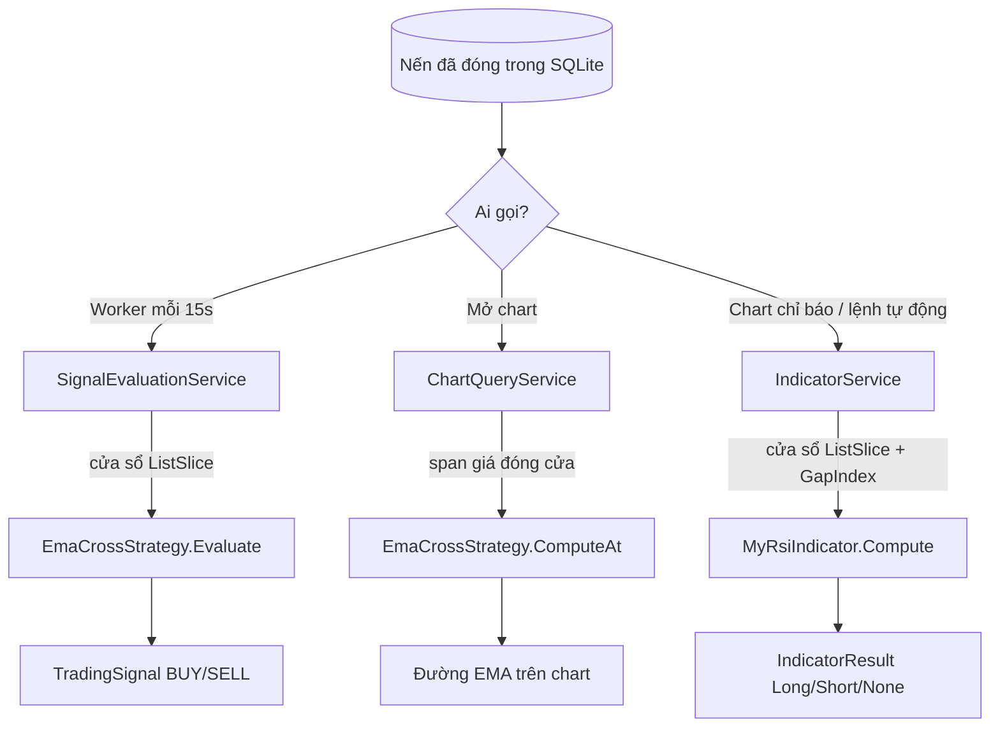

# Hàm sinh tín hiệu (EMA cross và MyRsi)

Tài liệu này giải thích cách bot "dự đoán", tức là quyết định phát tín hiệu **Long/BUY** hay **Short/SELL** trên mỗi nến đã đóng: code được chia nhỏ ra sao, chạy theo thứ tự nào, đã tối ưu những gì và làm sao để chắc chắn kết quả không đổi.

> Đây là quy tắc kỹ thuật dựa trên chỉ báo, không phải dự báo giá. Tín hiệu đúng về mặt tính toán không có nghĩa là có lãi.

## 1. Tổng quan

Có hai nguồn tín hiệu, cùng tuân theo một quy tắc:

| Nguồn | File | Tín hiệu |
| --- | --- | --- |
| Chiến lược EMA 9/21 | [`EmaCrossStrategy.cs`](../src/CryptoBot.Domain/Strategies/EmaCrossStrategy.cs) | BUY khi EMA nhanh cắt lên EMA chậm, SELL khi cắt xuống (chỉ khi đang giữ) |
| Chỉ báo MyRsi | [`MyRsiIndicator.cs`](../src/CryptoBot.Domain/Indicators/MyRsiIndicator.cs) | Không EMA: Long khi RSI cắt lên 30, Short khi cắt xuống 70. Có EMA xu hướng: Long khi giá trên EMA và RSI cắt lên 40, Short khi giá dưới EMA và RSI cắt xuống 60 |

**Quy tắc chung: cửa sổ cố định.** Mỗi nến được tính trên đúng N nến đã đóng gần nhất, kết thúc tại nến đó: 300 nến với EMA, 200 nến với MyRsi. EMA và RSI phụ thuộc điểm bắt đầu, nên cố định cửa sổ giúp chart, lệnh tự động và backtest luôn ra cùng một giá trị trên cùng dữ liệu. Đổi lại, mỗi nến phải tính lại từ đầu cửa sổ.

Hai hàm này **thuần túy**: không gọi API, không đọc đồng hồ, không nhớ trạng thái giữa các lần gọi. Cùng đầu vào luôn cho cùng đầu ra, nên dễ test.

## 2. Luồng chạy



Ba nơi gọi đều lặp qua từng nến và đưa vào hàm sinh tín hiệu một **cửa sổ** kết thúc tại nến đó.

## 3. Chiến lược EMA: `EmaCrossStrategy.Evaluate`

`Evaluate` chỉ còn ba bước, mỗi bước là một hàm nhỏ:

```text
Evaluate(context)
├── CheckInput(candles)        → Hold nếu chưa có nến / chưa đủ 300 nến; lỗi nếu có nến chưa đóng
├── ComputeLast(LastCloses())  → EMA9 và EMA21 tại nến trước và nến cuối (IndicatorValues)
└── Decide(values, context)
    ├── Crossover.Up   → OnCrossUp   : BUY, trừ khi đã có vị thế hoặc lệnh vào đang chờ
    ├── Crossover.Down → OnCrossDown : SELL, chỉ khi đang giữ vị thế (long-only)
    └── còn lại        → Hold "Không có giao cắt."
```

| Hàm | Việc làm |
| --- | --- |
| `CheckInput` | Không có nến → Hold. Có nến chưa đóng → lỗi (chiến lược chỉ nhận nến đã đóng). Ít hơn `LookbackCandles` nến → Hold "Warm-up". |
| `LastCloses` | Lấy giá đóng cửa của đúng `LookbackCandles` nến cuối. |
| `ComputeLast` | Gọi `Ema.LastTwo` cho EMA nhanh và chậm, trả về 4 số: fast/slow ở nến trước và nến cuối. |
| `Decide` | Có giao cắt lên/xuống không. |
| `OnCrossUp` / `OnCrossDown` | Áp luật vị thế để ra BUY, SELL hoặc Hold kèm lý do. |
| `ComputeAt(span)` | Dùng cho chart: chỉ tính EMA, không ra quyết định, nhận thẳng mảng giá đóng cửa. |

## 4. Chỉ báo MyRsi: `MyRsiIndicator.Compute`

File này đồng thời là **mẫu để bạn tự viết chỉ báo**, nên vẫn giữ 4 phần: tham số, kiểm tra tham số, cách vẽ, công thức. Phần 4 được chia thành các bước:

```text
Compute(closedCandles)
├── Warm-up: chưa đủ LookbackCandles nến → None
├── 4a ReadRsi(closes)       → RSI nến trước (Prev) và nến vừa đóng (Now)
├── 4b ReadTrendEma(closes)  → EMA xu hướng, hoặc null nếu TrendEmaPeriod = 0
├── 4c BuildValues(...)      → giá trị để vẽ: "rsi" (làm tròn 2 số), "ema" nếu có
├── không có EMA → 4d ReversalSignal
│   ├── RSI cắt lên Oversold (30)     → Long
│   ├── RSI cắt xuống Overbought (70) → Short
│   └── còn lại                       → None "RSI x, không cắt mức."
└── có EMA      → 4e PullbackSignal (hồi trong xu hướng)
    ├── RSI cắt lên PullbackLong (40)   → Long nếu giá đóng cửa trên EMA, ngược lại None kèm lý do
    ├── RSI cắt xuống PullbackShort (60)→ Short nếu giá đóng cửa dưới EMA, ngược lại None kèm lý do
    └── còn lại                         → None "RSI x, không cắt mức hồi."
```

Vì sao có EMA thì không dùng 30/70 (sửa ở PR #48): RSI vừa dưới 30 thì giá gần như luôn dưới EMA, nên điều kiện
"cắt lên 30 **và** giá trên EMA" hầu như không xảy ra (0 tín hiệu trên nến 15m/1h). Trong xu hướng tăng RSI thường chỉ
lùi về quanh 40 rồi bật lên, trong xu hướng giảm chỉ hồi lên quanh 60 rồi quay xuống.

Khi tự viết chỉ báo, bạn có thể dùng lại các khối sẵn có thay vì tự viết lại vòng lặp:

| Khối dùng chung | File | Dùng để |
| --- | --- | --- |
| `Crossover.Up / Down` | [`Crossover.cs`](../src/CryptoBot.Domain/Strategies/Crossover.cs) | Hai đường cắt nhau (ví dụ EMA nhanh/chậm) |
| `Crossover.UpThrough / DownThrough` | như trên | Một giá trị cắt qua mức cố định (ví dụ RSI qua 30/70) |
| `Ema.LastTwo` | [`Ema.cs`](../src/CryptoBot.Domain/Strategies/Ema.cs) | EMA tại nến trước và nến cuối |
| `Rsi.LastTwo` | [`Rsi.cs`](../src/CryptoBot.Domain/Indicators/Rsi.cs) | RSI tại nến trước và nến cuối |
| `IndicatorWindow.LastCloses` | [`IndicatorContracts.cs`](../src/CryptoBot.Domain/Indicators/IndicatorContracts.cs) | Giá đóng cửa của N nến cuối |

"Cắt lên" nghĩa là nến trước còn **≤** mức và nến này đã **>** mức. "Cắt xuống" nghĩa là nến trước còn **≥** mức và nến này đã **<** mức. Nhờ vậy một giao cắt chỉ phát tín hiệu đúng một lần, không lặp lại ở các nến sau.

## 5. Đã tối ưu những gì

Quy tắc cửa sổ cố định được giữ nguyên, tức là mỗi nến vẫn tính lại EMA/RSI trên cả cửa sổ. Phần được bỏ là các việc tốn thừa xung quanh phép tính:

| Trước | Sau | File |
| --- | --- | --- |
| Tạo mảng `decimal?[]` cho cả cửa sổ, chỉ dùng 2 phần tử cuối | `Ema.LastTwo` / `Rsi.LastTwo` chỉ giữ giá trị đang chạy, không cấp phát mảng | `Ema.cs`, `Rsi.cs` |
| Tính lại `1 − alpha` ở mỗi vòng lặp EMA | Tính một lần trước vòng lặp | `Ema.cs` |
| `List.GetRange` sao chép 200–300 tham chiếu nến cho **mỗi** nến | `ListSlice` chỉ là một view trên danh sách gốc | [`ListSlice.cs`](../src/CryptoBot.Domain/Common/ListSlice.cs), `SignalEvaluationService.cs`, `IndicatorService.cs` |
| Chart EMA tạo lại cửa sổ nến rồi trích giá cho mỗi nến | Trích giá đóng cửa một lần, mỗi nến chỉ truyền một đoạn `span` | [`ChartQueryService.cs`](../src/CryptoBot.Application/Signals/ChartQueryService.cs) |
| Chỉ báo quét lại cả cửa sổ để tìm nến thiếu ở mỗi nến | `GapIndex` tính một lần cho cả chuỗi, mỗi cửa sổ chỉ tra mảng | [`IndicatorService.cs`](../src/CryptoBot.Application/Indicators/IndicatorService.cs) |

**Tại sao kết quả không đổi:** các hàm mới làm **đúng các phép tính cũ theo đúng thứ tự**, chỉ bỏ phần lưu trữ và sao chép. Với `decimal`, cùng phép tính theo cùng thứ tự luôn cho cùng kết quả, kể cả số chữ số sau dấu phẩy.

**`GapIndex` hoạt động thế nào:** với mỗi vị trí `j`, mảng `next[j]` lưu vị trí nến đầu tiên từ `j` trở đi đứng ngay sau một khoảng thiếu. Một cửa sổ có nến thiếu khi `next[đầu phạm vi kiểm tra] ≤ cuối cửa sổ`. Phạm vi kiểm tra giống hệt code cũ: `RequiredCandles` nến cuối của cửa sổ.

### Số đo

Đo bằng bản Release trên 1,000–1,200 nến giả lập:

| Tác vụ | Trước | Sau |
| --- | --- | --- |
| Chart MyRsi | 90.3 ms | 41.9 ms |
| Chart MyRsi + EMA50 | 111.8 ms | 63.3 ms |
| Chart EMA | 57.6 ms, cấp phát 21 MB | 51.5 ms, cấp phát 0.2 MB |
| Đánh giá tín hiệu | 70.5 ms | 69.0 ms |

Phần EMA gần như không nhanh hơn vì thời gian còn lại là chính các phép nhân/cộng `decimal` mà quy tắc cửa sổ cố định buộc phải làm lại cho mỗi nến. Muốn nhanh hơn nữa có hai hướng, hiện chưa làm:

- **Tính song song nhiều nến:** kết quả vẫn giữ nguyên, nhưng thêm độ phức tạp, và chỉ đáng làm khi chart thật sự chậm.
- **Bỏ cửa sổ cố định, tính EMA liên tục trên cả chuỗi:** nhanh hơn nhiều, nhưng **tín hiệu sẽ thay đổi** và chart có thể lệch với lệnh tự động.

## 6. Golden test: bảo đảm kết quả không đổi

[`SignalGoldenTests.cs`](../tests/CryptoBot.Application.Tests/SignalGoldenTests.cs) chạy cả ba đường (đánh giá tín hiệu, chart EMA, chỉ báo MyRsi có và không có bộ lọc xu hướng) trên 1,500 nến giả lập cố định, có xen một nến thiếu. Toàn bộ đầu ra được so với file [`Golden/signal_outputs.txt`](../tests/CryptoBot.Application.Tests/Golden/signal_outputs.txt), dài 3,026 dòng. File này được tạo từ code **trước khi** tối ưu (PR #9), và cập nhật có chủ đích một lần ở PR #48 khi đổi luật MyRsi có EMA.

- **Tối ưu hoặc tách hàm:** golden test phải pass. Nếu fail nghĩa là kết quả đã đổi, cần xem lại.
- **Cố ý đổi công thức** (ví dụ đổi luật vào lệnh): golden test sẽ fail, đó là điều mong đợi. Cập nhật snapshot bằng lệnh dưới đây, rồi đọc kỹ diff của `signal_outputs.txt` trước khi commit để thấy chính xác tín hiệu nào thay đổi.

```bash
UPDATE_GOLDEN=1 dotnet test
```

Các khối nhỏ có test riêng trong [`SignalBuildingBlockTests.cs`](../tests/CryptoBot.Domain.Tests/SignalBuildingBlockTests.cs): `LastTwo` khớp với đuôi của `Calculate`, các luật giao cắt, `ListSlice`, và hai cách gọi `ComputeAt`.
